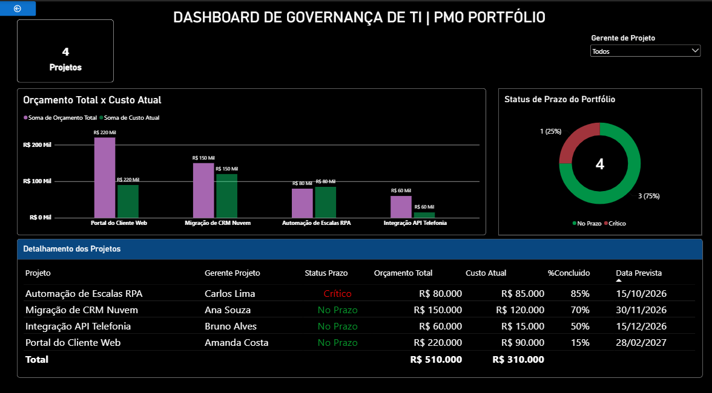

# Dashboard de Governança de TI | PMO Portfólio

## 📋 Visão Geral do Projeto
Em ambientes de tecnologia, gerenciar múltiplos projetos simultaneamente exige visibilidade rápida sobre custos e prazos para evitar desperdícios. Este projeto consiste em um dashboard gerencial dinâmico desenvolvido no Power BI, focado em trazer previsibilidade financeira e operacional para lideranças e tomadores de decisão (PMO).

---

## 🛠️ Tecnologias e Conceitos Utilizados
* **Power BI:** Conexão, tratamento de dados, modelagem e design de interface.
* **Excel:** Estruturação das bases de dados simuladas.
* **Governança corporativa:** Indicadores baseados nos pilares de Escopo, Tempo (Prazo) e Custo.
* **Design UI/UX:** Interface moderna em modo escuro com alto contraste para facilitar a leitura executiva.

---

## 📊 O Dashboard

## 🎯 Soluções Práticas Apresentadas

---

## 🎯 Soluções Práticas Apresentadas

1. **Gestão Orçamentária Centralizada:** Gráficos comparativos de *Orçamento Total vs. Custo Atual*, permitindo identificar desvios financeiros imediatos de projetos que ultrapassaram a estimativa inicial.
2. **Saúde do Portfólio (Prazos):** Indicador visual do status dos projetos (No Prazo vs. Crítico), sinalizando de forma preditiva onde a liderança precisa intervir.
3. **Detalhamento Granular:** Tabela analítica que consolida os responsáveis (Gerentes de Projetos), percentuais de conclusão e datas previstas, eliminando a necessidade de consolidações manuais de planilhas.

---

## 🧠 Aprendizados de Negócio
Desenvolver este painel demonstrou como a análise de dados pode mitigar riscos operacionais de forma preventiva. Por exemplo, na simulação apresentada, o projeto *"Automação de Escalas RPA"* já atingiu um status crítico de prazo e custo antes mesmo de sua conclusão, gerando um alerta visual imediato para que o comitê tome ações de correção de rota.

---
✉️ **Contato:** 
* **LinkedIn:** (https://www.linkedin.com/in/deyse-santos-064971340)

